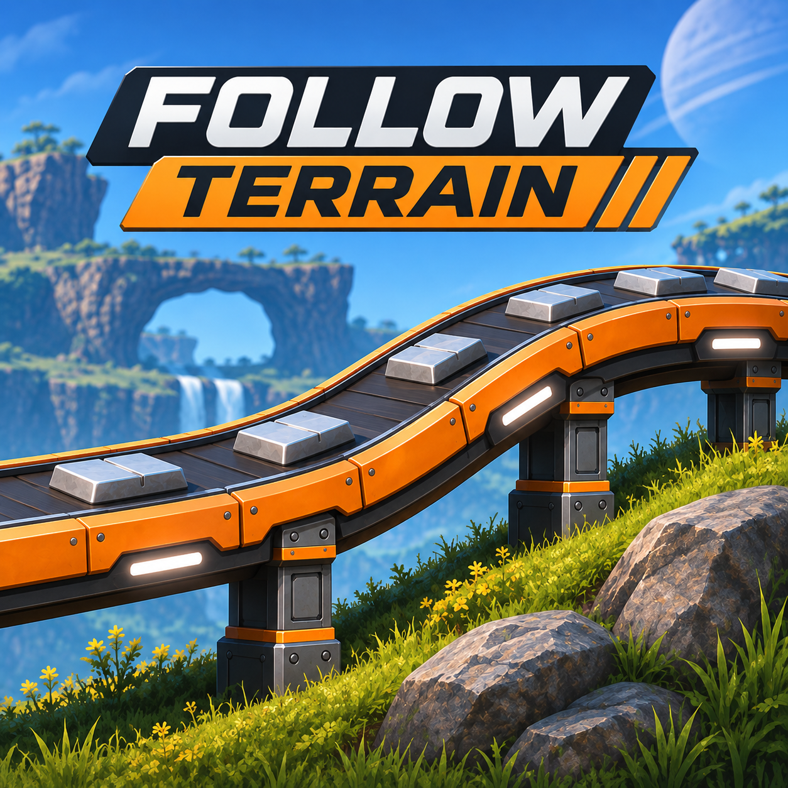

# Follow Terrain

Adds a **Follow Terrain** build mode to conveyor belts, pipes, hypertubes and railway tracks. Drag one
across a hill and it drapes over the ground instead of cutting straight through it.

## Features

- **Follow Terrain build mode:** cycle build modes while holding a belt, pipe, hypertube or track and pick
  *Follow Terrain*. The route keeps the same shape from above as vanilla's; only the height changes, so
  it hugs the slope.
- **Stays within the game's limits:** slopes are capped at the belt's or pipe's maximum incline, and
  bumps are smoothed so the result passes the game's own curvature checks. Where the ground is too steep,
  the line is lifted rather than sunk, so it never ends up underground.
- **Automatic conveyor lifts:** when a belt meets a slope too steep for it, a conveyor lift is placed
  there and the belt carries on from the other end. Belt, lift and second belt are built and charged as
  one placement.
- **Pipe steps:** on big steep drops, pipes get a vertical riser instead of a long ramp.
- **Snapping still works:** the ends of the line are never moved, so snapping to machines, poles and
  other belts behaves as it does in vanilla.
- **Falls back to vanilla:** if a draped shape can't be placed, you get the vanilla shape instead of an
  invalid hologram.

Railway tracks have no build modes of their own, so they get a *Default* mode alongside Follow Terrain.

## Multiplayer

Every player needs the mod. **Multiplayer and dedicated servers have not been tested yet.** If
something misbehaves for clients, please open an issue.

## Known limitations

- Draped lines are longer than straight ones, so on hilly ground you hit the maximum belt length sooner,
  and they cost a little more.
- Under overhangs and in caves the ground check can land on the ceiling.
- On hilly ground, railway tracks can only rise, so they may end up raised well above the ground.
- Blueprints and the blueprint designer are not supported yet.

Source: https://github.com/leanwrldd/FollowTerrain
